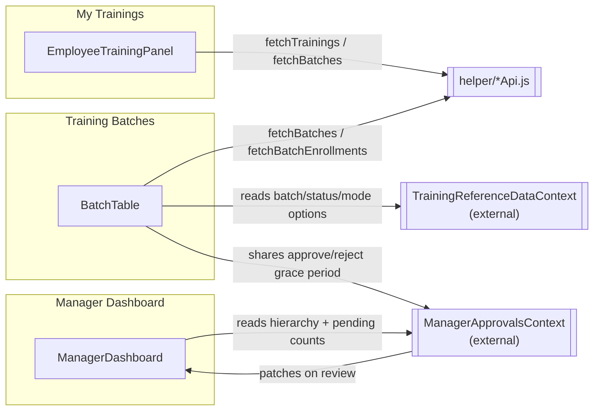

# Training Feature

The training feature lets employees track their own training records and request open-enrollment batches, lets managers review their team's training progress and pending nominations, and lets Admin/Dept/HR staff create and manage training batches and enrollments.

## Feature Areas

- **My Trainings** — an employee's own training records, with filtering, search, and self-service nomination into open-enrollment batches. Always self-scoped; every employee sees this.
- **Manager Dashboard** — a manager's view of their team's training status, skill/certification gaps, and pending nomination requests, with drill-down into sub-teams.
- **Training Batches** — the admin console for creating and editing training batches and managing enrollments, including approving or rejecting pending nominations.
- **Shared training layer** — cross-page UI components, search/filter primitives, record adapters, and hooks reused by all three pages above.

## Folder Structure

```
features/training/
├── my-trainings/
│   ├── components/
│   │   ├── EmployeeTrainingPanel.jsx    # composition root
│   │   ├── OpenEnrollmentGrid.jsx       # "Open for Enrollment" catalog view
│   │   └── IncompleteTrainingCard.jsx   # incomplete-training reasons on the nomination panel
│   ├── hooks/
│   │   └── useOpenEnrollmentBatches.js  # derives the open-batch card list + counts
│   └── services/                        # query building, search, view-scope config
│
├── manager-dashboard/
│   ├── components/
│   │   ├── ManagerDashboard.jsx         # composition root
│   │   ├── TeamTrainingStatusCard.jsx   # By Employee / By Training toggle, search, breadcrumb
│   │   ├── EmployeeList.jsx / EmployeeRow.jsx / EmployeeExpandedRecords.jsx
│   │   ├── KpiHero.jsx / TeamAlertsCard.jsx / SkillDomainsCard.jsx / SkillLevelDistributionCard.jsx
│   │   └── TrainingBatchGroup*.jsx      # "By Training" batch-grouped nominee lists
│   ├── hooks/                           # hierarchy view, batch grouping, scope summary
│   └── services/                        # pending-request collection, hierarchy patching, grouping
│
├── training-batch/
│   ├── components/
│   │   ├── AdminTrainingDashboard.jsx   # composition root
│   │   ├── BatchTable.jsx               # batch list, filters, pagination, approvals
│   │   ├── BatchRow.jsx / BatchDetailPanel.jsx / BatchTableCells.jsx
│   │   ├── InlineCreatePanel.jsx        # Create/Edit Batch form
│   │   ├── EnrollmentTable.jsx          # enrollment table + add/edit form (EnrollmentPanel)
│   │   ├── BatchNotesPanel.jsx / BatchPendingApprovalsDetail.jsx / ApprovalsBulkActionBar.jsx
│   │   └── ErrorBoundary.jsx / LiveSelect.jsx / DetailPanel.jsx
│   ├── context/
│   │   └── TrainingBatchOriginContext.jsx
│   ├── hooks/                           # approvals selection, submit guard, retry-on-open
│   ├── services/                        # permissions, scopes, search, optimistic merge, etc.
│   └── index.js                         # exports AdminTrainingDashboard, BatchTable
│
└── shared/
    ├── components/
    │   ├── EntityCard.jsx / EntityCardGrid.jsx   # generic record card + grid
    │   ├── StatusPill.jsx / StatusTabs.jsx / StatBadge.jsx / CountBadge.jsx / Tooltip.jsx
    │   ├── DetailList.jsx / DetailListItem.jsx
    │   ├── Breadcrumb.jsx / SegmentedToggle.jsx / SelfManagerToggle.jsx / YearFilter.jsx
    │   ├── TrainingProgressCard.jsx / PendingApprovalsCard.jsx / OpenBatchesCard.jsx / BatchListItem.jsx
    │   ├── HighlightMatch.jsx / InlineDecisionPanel.jsx / NotificationBellButton.jsx / NotCompletedPill.jsx
    │   ├── Modal.jsx / Collapse.jsx / CardListPagination.jsx / LoadingSpinner.jsx / ScrollFadeContainer.jsx
    │   └── filters/          # ColumnFilterIcon, FilterChip, FilterPopover, MultiSelectFilter,
    │                         # SearchToggle, SearchMatchNav, SearchScopeLabel, IconRevealTrigger
    ├── config/               # trainingRecordAdapter, certRecordAdapter, batchStatusColors,
    │                         # searchMatch, trainingStatusBuckets, technologyBanners, skill helpers
    └── hooks/                # useDebouncedValue, useScrollResetOnChange, useUrlSearchParam, useCollapsedList
```

## Architecture

Each of the three pages has its own composition root that owns page-level state and composes feature-local components:

- **My Trainings** — `my-trainings/components/EmployeeTrainingPanel.jsx`
- **Manager Dashboard** — `manager-dashboard/components/ManagerDashboard.jsx`
- **Training Batches** — `training-batch/components/AdminTrainingDashboard.jsx`, which renders `BatchTable.jsx`

Each page follows the same internal layering:

- **Components** (`components/`) render UI and hold page-local UI state (which row is expanded, which panel is open).
- **Hooks** (`hooks/`) own derived data and side effects (fetching, filtering, aggregation) that a component would otherwise recompute inline.
- **Services** (`services/`) hold pure, framework-free logic: filtering, permission checks, payload building, search field configuration.
- **Config/adapters** (`shared/config/`) normalize raw API records (camelCase vs snake_case, legacy field names) into one canonical shape and map that shape onto `EntityCard`'s generic prop contract, so trainings and certifications render through the same card component.

`training-batch/context/TrainingBatchOriginContext.jsx` is the only React Context defined inside this feature. It carries which entry point (`BATCH_VIEW_ORIGIN.DIRECT` or `BATCH_VIEW_ORIGIN.MANAGER_DASHBOARD`) brought the user to Training Batches, so deeply nested components (`BatchRow.jsx`, `EnrollmentTable.jsx`) can read it via `useTrainingBatchOrigin()` without prop drilling.

Two contexts the feature depends on but does not own live in `frontend/src/context/`:

- `ManagerApprovalsContext` (`useManagerApprovals()`) owns the shared hierarchy snapshot, pending-approval counts, and the approve/reject grace-period workflow (`useApprovalGracePeriod`, actually invoked from inside this context, not from any component in `manager-dashboard/`). `ManagerDashboard.jsx`, `BatchTable.jsx`, and `BatchRow.jsx` all read from it directly rather than through props.
- `TrainingReferenceDataContext` (`useTrainingReferenceData()`) prefetches batch-status, training-mode, training-status, and hierarchy option lists once at app load; `BatchTable.jsx`, `InlineCreatePanel.jsx`, and `EnrollmentTable.jsx` read from it instead of each fetching their own copy.

A small number of app-level hooks from `frontend/src/hooks/` are used across this feature for navigation and auth (`useAuth`, `useGoToTrainingBatches`, `useOpenEnrollmentView`, `usePortalPosition`, `useDelayedDisclosure`, `useFocusTrap`, `useExpandedSet`) — these are integration points, not part of this feature's own surface.

**State ownership**: each page's composition root owns the state that only it needs (filters, pagination, which row is expanded); state that must be consistent across pages (pending-approval counts, the live hierarchy snapshot, reference option lists) lives in the two external contexts above.

**Refetch behavior**: no page in this feature polls in the background. Data is fetched once on mount and refetched or patched explicitly after a mutation:

- My Trainings refetches both trainings and batches (`refetchTrainingsAndBatches`) after a nomination is submitted.
- Training Batches keeps a shared `enrollmentsCache` (in `BatchTable.jsx`) that is invalidated or updated in place after every enrollment add/edit/delete, and reconciles optimistic local edits against a background fetch via `mergeBatchesWithLocalOptimism`.
- Manager Dashboard patches its local hierarchy snapshot in place after an approve/reject (`applyTrainingReviewResults` in `hierarchyPatching.js`) instead of waiting for a full refetch, and also listens for the same event (`subscribeReviewed`) to force-refresh only the Training Batches enrollment rows that are already cached.

## My Trainings

**Purpose**: an employee's own training records — filter, search, and view detail — plus a separate "Open for Enrollment" catalog for self-nominating into open batches.

**Composition root**: `my-trainings/components/EmployeeTrainingPanel.jsx`. It owns the active status bucket, year, search text, advanced filters (status/mode/training quarter), sort order, pagination, and the `viewScope` toggle between the default record list and the open-enrollment catalog (`useOpenEnrollmentView`, an app-level hook).

**Main child component**: `OpenEnrollmentGrid.jsx` renders the open-batch catalog and hosts the inline nomination form (built on `shared/components/InlineDecisionPanel.jsx`), where `IncompleteTrainingCard.jsx` asks for a reason on each "Not Completed" training before Submit (saved to `status_remarks`); its header shows "X of your N trainings are not completed yet" and each name links to its batch. A full batch (`employee_count` ≥ `batch_size`) still shows, but with a "Batch Full" badge and a "No seats left right now" note, faded, with View Details instead of the request button.

**Hooks**: `useOpenEnrollmentBatches` (in `my-trainings/hooks/`) derives the open-batch card list, per-batch personal status, and an `actionableCount` from `batches` and the employee's own `trainings` — it does no fetching itself. Cards are ordered by batch start date, earliest first. A batch with no start date sorts last, and the same date falls back to module name.

**Services** (`my-trainings/services/`):

- `myTrainingsQuery.js` builds the `GET /add_training_v2` query params and reduces the raw response into the paginated, filtered, sorted list the panel renders. It also defines `CARDS_PER_PAGE = 6` for My Trainings and `OPEN_ENROLLMENT_PAGE_SIZE = 4` for this catalog.
- `batchCardAdapter.jsx` maps one open-enrollment batch to `EntityCard`'s prop shape and owns the seat rules (`getSeatsAvailable`) and `REQUEST_ACTION_BY_STATUS`, the single lookup for what a card's CTA/badge/highlight should be for a given personal nomination status. The calendar line is the batch start date. For New/Retry cards, View Details is a separate `secondaryAction` link that `OpenEnrollmentGrid.jsx` lays over the card's footer. Only this catalog uses a slightly shorter card (`min-h-[320px]`); other EntityCard views stay at the default height.
- `batchNewIndicator.js`, `newOpenEnrollmentCount.js`, `openEnrollmentSearch.js`, `openEnrollmentViewScope.js` — "is this batch new," shared new-batch counts (also read by `SelfDashboard.jsx` outside this feature), open-batch search fields, and the default-vs-catalog view-scope configuration, respectively.

**Non-obvious contracts a contributor must preserve**:

- Most of `GET /add_training_v2`'s query parameters (`status`, `q`, `mode`) are accepted by the backend but not applied server-side. `needsClientPostFilter` / `applyClientPostFilters` compensate by re-filtering client-side whenever any of those parameters, or the training-quarter filter (which has no server parameter at all), are active. Server-side pagination (`useServerPagination`) is only used when no client-side post-filter is needed.
- Trainer, duration, training mode, batch size, and training quarter live on the **batch**, not the per-employee training record. `mergeBatchDetails` (in `shared/config/trainingRecordAdapter.jsx`) splices them onto a raw record using a `batchByNum` map before anything reads them.
- Filters are persisted per employee in `sessionStorage` (key prefix `skillMatrix.myTrainings.filters.v1.`); the persisted shape is merged with `EMPTY_ADV_FILTERS` (not read with `??`) so a session saved before a new filter key existed doesn't crash on the missing key.
- The search term is synced to the `mt_q` URL query parameter (`useUrlSearchParam`, in `shared/hooks/`) — every page in this feature uses its own parameter name (`mt_q`, `md_q`, `batch_q`) since the app has no router and all three pages share one URL.
- Loading, error, and empty states are handled explicitly in `EmployeeTrainingPanel.jsx`: a spinner while `loading`, a dedicated message when `fetchError` is set, and a distinct empty state (with a "Clear Filters" action) when the filtered result is empty.

## Quiz

**Purpose**: an employee attempts a lesson quiz or an end-of-course assessment through the backend `attempt_quiz_v2` function (`docs/quiz/attemptQuiz_v2.md`).

- `quiz/components/QuizPlayer.jsx` shows one question at a time: radio buttons for Single Choice, checkboxes for Multiple Choice, Previous/Next, and Submit on the last question. Loading, load-error, submit-error and result (score, percentage, pass/fail) are separate states. Pass `quizId`, or `moduleId` + `quizType` (`Lesson` / `Course Assessment`).
- `quiz/hooks/useQuizAttempt.js` starts (or resumes) the attempt and holds the state. It exposes `answers` (map `question_id → option_ids`), `currentIndex` and `goTo(index)` so the question palette can plug in. Saved answers of a resumed attempt are restored. Submit first saves every answer that differs from what the server has, then submits; a `useSubmitGuard` lock blocks a double submit.
- `quiz/services/quizAnswers.js` holds the pure answers-map logic. The axios calls are in `helper/quizAttemptApi.js`.
- **Launch point**: `EmployeeTrainingPanel` accepts an optional `initialQuiz` prop (`{ quizId }` or `{ moduleId, quizType }`); when set it shows the player instead of the list, and closing returns to My Trainings.

## Manager Dashboard

**Purpose**: a manager's rollup of their team's training, skill, and certification status, plus a lightweight path into reviewing pending nominations.

**Composition root**: `manager-dashboard/components/ManagerDashboard.jsx`. It owns `scope` (`"direct"` or `"all"`), `viewMode` (`"employee"` or `"training"`), the active status bucket, an optional `alertFilter` (from a Team Alert), and search state, and composes `TeamTrainingStatusCard`, `KpiHero`, `TeamAlertsCard`, `SkillDomainsCard`, and `SkillLevelDistributionCard`.

**Hierarchy and scope handling**: `scope` toggles between the manager's direct reports and their entire recursive team. A third, Admin-only UI option, "Entire Organization," is not a third `scope` value — it is `scope = "all"` plus a separate, orthogonal `orgWideView` flag owned by `ManagerApprovalsContext`. `ManagerDashboard.jsx`'s `handleScopeChange`/`pillValue` are the one place that composes and decomposes the two back into the single three-option pill shown in `TeamTrainingStatusCard.jsx`.

**Direct Reports / Entire Team / organization-wide behavior**: within "Entire Team," `useTeamHierarchyView` (in `manager-dashboard/hooks/`) additionally supports breadcrumb drill-down into a sub-manager's own team, entirely client-side (the whole tree the manager can see is already resident from one hierarchy fetch). "Entire Organization" re-roots that same fetch at the organization root instead of the manager's own node; this requires `ORG_WIDE_VIEW_ROLES` (Admin only — see Access and Visibility below).

**Employee list and drill-down**: `EmployeeList.jsx` renders either the current drill-level roster or, during a global name search, a flat ranked result list capped at `GLOBAL_SEARCH_RESULT_CAP` (50) with a "Showing N of M" notice for anything beyond the cap. `EmployeeRow.jsx` renders one row: a drillable manager row exposes a "View team" action (navigates into that person's subtree) plus its own expand toggle for that manager's personal records; a non-drillable row's whole row is the expand toggle. Each row surfaces Skills/Certificates/Assigned `StatBadge`s with a hover/focus detail panel (`shared/components/Tooltip.jsx` in `variant="panel"` mode, backed by `DetailList`/`DetailListItem`), and a `NotCompletedPill` that opens a reasons popover (`NotCompletedPreview.jsx`).

**KPI behavior**: `KpiHero.jsx` renders a config-driven row of tiles (Team Members, Total Skills, Total Certifications, Total Trainings, Pending Approvals). Each tile's value comes from `kpiStats`, which reuses whichever view's own already-filtered data is on screen (search results, status/alert filter, or the current drill position) so the number can never disagree with the visible list. Clicking a tile switches `viewMode` and/or scrolls to the relevant section rather than opening a separate drawer.

**Search and match navigation**: local (in-scope) search shows a plain match-count pill; global search (Entire Team scope) turns the result list into a roving-focus listbox navigable with arrow keys and reports its true match count separately from the rendered cap. See Search and Filtering below for the shared contract.

**Training disclosure**: expanding an employee row inline (`EmployeeExpandedRecords.jsx`) shows only the most relevant trainings (in-progress first, then most recently started), capped at `INLINE_TRAINING_LIMIT = 3`. Beyond that cap, a "View all N trainings" link navigates to Training Batches scoped to that employee's own batch numbers (`BATCH_SCOPE.EMPLOYEE`) — there is no in-dashboard drawer or second list for the full set.

**Pending nomination review behavior**: the "By Training" view (`viewMode = "training"`) groups nominees by batch via `useTrainingBatchGroups` and is read-only — `TrainingBatchNomineeRow.jsx` renders only a name and status pill, with no Approve/Reject controls. Approval and rejection are performed from Training Batches: the "Pending Approvals" KPI tile and the dismissible `ManagerAlertBanner` both navigate there with `BATCH_SCOPE.PENDING_APPROVALS`, where the real inline approve/reject controls and the bulk-selection bar live.

**Important contexts, hooks, services**:

- `useTeamHierarchyView` — the single source of the "By Employee" roster: breadcrumb drill-down, flat direct-reports list, global search, and per-row pending-request counts.
- `useTeamScopeSummary` — root-scoped status-bucket counts for the "By Training" view (which has no breadcrumb position of its own).
- `useTrainingBatchGroups` — batch-grouped nominee data for the read-only "By Training" view.
- `useBatchByNum` — fetches the batch list once and indexes it by `batch_num`, shared by every surface on this page that needs batch-level metadata merged onto a raw training record.
- `services/pendingRequests.js`, `hierarchyPatching.js`, `teamGrouping.js` — pending-request collection, client-side hierarchy patching after a review, and the shared "group by manager" utility used by both the alert-matches view and the "By Training" nominee list.
- `services/testDataFilters.js` — filters seed/QA fixture records (a `DUMMY_QA_` prefix or a small set of placeholder names) out of every manager-facing training/certification list.

**Non-obvious contracts a contributor must preserve**:

- `role` and `isManager` are independent (see Access and Visibility). `ManagerDashboard.jsx` is reachable via `isManager || canViewOrgWide`, not `isManager` alone.
- Team Alerts, Top Skill Domains, and Skill Level Distribution re-root to the current breadcrumb drill position (`drillScopedStats`), independent of search/status filters, which only ever narrow the KPI row.
- The "Total Trainings" KPI tile reflects the current drill position, but clicking it opens the "By Training" view, whose batch grouping is always scope-wide rather than re-rooted to that same drill position.

## Training Batches

**Purpose**: the admin console for creating and editing training batches, managing per-batch enrollments, and reviewing pending nominations. Full read/write access is limited to Admin, Dept, and HR; other roles can still reach it via a scoped deep link with reduced, own-record-only access.

**Composition root**: `training-batch/components/AdminTrainingDashboard.jsx`, which renders the page header, breadcrumb, search, and `BatchTable.jsx` inside an `ErrorBoundary` and a `TrainingBatchOriginProvider`.

**Batch list and detail behavior**: `BatchTable.jsx` owns the batch list, filters (`batch`, `module`, `quarter`, `status`), search, and pagination. Rows-per-page is computed dynamically at render time from the first row's measured height and the viewport (`recalcRowsPerPage`, bounded `MIN_ROWS_PER_PAGE = 4` .. `MAX_ROWS_PER_PAGE = 20`), not a fixed page size. Expanding a row (`BatchRow.jsx`) reveals `BatchDetailPanel.jsx`, which renders three independently-collapsible sections: **Batch Details** (schema-driven read view via `OVERVIEW_FIELDS`), **Enrollments** (`BatchEnrollmentPanel`, the default export of `EnrollmentTable.jsx`), and **Notes** (`BatchNotesPanel.jsx`, backed by the `manage_comments_v2` endpoint, view-and-add only).

**Create and edit behavior**: `InlineCreatePanel.jsx` handles both modes. Create mode supports stacking multiple batch drafts in one panel (`rows`, each starting from `emptyBatchRow()`) with a "+ Add another batch" action; edit mode edits a single row seeded from `rowFromBatch(initialData)`. Both modes support staging enrollment picks before the batch itself is saved: create mode always defers (`deferSave`) since no `batch_id` exists yet; edit mode's own "+ Add Enrollment" also defers and submits the staged picks via `addTrainingBatch` right after `updateBatch` succeeds. Create mode can also be prefilled from an array of batches (the `create_batch_payload.json` shape, e.g. the Training Calendar app's JSON export): via the create-batch deep link (`initialData`), or the **Import JSON** button in the Create panel's title bar, which replaces the untouched starting card or otherwise appends after the user's cards. Both check the file with `isBatchPayload` (`hooks/useTrainingEmailDeepLink.js`), flag missing required fields on the imported cards right away, and open "View More" on cards that have data there; nothing saves until Save.

**Enrollment management**: `EnrollmentTable.jsx` exports `EnrollmentPanel` (the add/edit form, reused standalone and, in staged mode, from `InlineCreatePanel.jsx`) and, as its default export, `BatchEnrollmentPanel` (the read/paginated table, `ENROLLMENTS_PER_PAGE = 8`; its Manager Email column has a shared `CopyButton`). Deleting or editing an enrollment updates the batch row's own `employee_count` instantly via a numeric delta (`onEnrollmentChange(-1|+1)`) rather than waiting for a full reload.

**Pending approval handling**: `BatchPendingApprovalsDetail.jsx` (exported as `BatchPendingApprovalsDisclosure` from `BatchPendingApprovalsBanner.jsx`) renders a per-batch, collapsible list of pending requests with inline Approve/Reject (`InlineDecisionPanel`) and an "Undo" grace window. Each request also shows the nominee's "Not Completed" trainings, reasons and batch links (shared `BatchLink.jsx`, also used by `IncompleteTrainingCard.jsx`; "N not completed out of M trainings attended") via `shared/components/NotCompletedSummary.jsx`. `ApprovalsBulkActionBar.jsx` provides the same actions across a multi-batch selection (`useApprovalsSelection`, in `training-batch/hooks/`). Approve/reject calls flow through `ManagerApprovalsContext`'s `scheduleApprove`/`scheduleReject`, which apply a grace period (`APPROVAL_GRACE_MS` / `APPROVAL_BULK_GRACE_MS`, defined in `manager-dashboard/hooks/useApprovalGracePeriod.js`) before the real API call commits. Batches reviewed on the visit stay listed with Enrollments open, decided rows highlighted, and an "All caught up" summary once none are left.

**Search, filtering, pagination, and nested matches**: see Search and Filtering below — Training Batches has the fullest implementation of the shared search contract, including nested-employee matches and an exhaustive search-coverage prefetch.

**Permission handling**: `services/batchPermissions.js` (`useBatchPermissions()`, `BATCH_ACTIONS`, `canPerformBatchAction`) and `services/batchViewOrigin.js` (`BATCH_VIEW_ORIGIN`, origin-based action hiding) — see Access and Visibility.

**Navigation-origin and deep-link behavior**: `services/batchScopes.js` defines `BATCH_SCOPE` (`BATCH`, `OWN`, `TEAM`, `EMPLOYEE`, `PENDING_APPROVALS`) — the set of "land here already filtered" targets other pages can request. `BatchTable.jsx` resolves a `scopeTarget` prop into either an expanded single row (`BATCH_SCOPE.BATCH`, no scope not set) or a narrowed Batch Number filter plus a dismissible "Scope: X" pill (the other scopes). `TrainingBatchOriginContext.jsx` separately tracks which page origin (`BATCH_VIEW_ORIGIN`) the visit came through, which narrows which actions are available rather than which batches are visible.

**Important hooks and services**:

- `useApprovalsSelection` — multi-select state (per-request and per-batch) for bulk approve/reject.
- `useRetryOnOpen` — gives a prefetched `TrainingReferenceDataContext` resource one retry attempt when the panel that needs it opens, if the background prefetch had failed.
- `useSubmitGuard` — a same-tick double-click guard for destructive/one-shot actions (delete confirm, save).
- `useScrollIntoViewOnOpen` — returns a ref; smooth-scrolls that panel into view when its open key (e.g. the record being edited) becomes truthy. Used by the Edit Batch panel (`BatchTable.jsx`) and the Edit Enrollment panel (`EnrollmentTable.jsx`).
- `services/batchOptimisticMerge.js` (`mergeBatchesWithLocalOptimism`) — reconciles a fresh batch-list fetch with any in-flight local optimistic create/edit/delete so a background fetch can't revert or flicker a change the current tab just made.
- `services/enrollmentVisibility.js` — own-record-only enrollment filtering for restricted roles, applied client-side.
- `services/trainingQuarter.js` — derives the fiscal-year `"YYYY-Qn"` label from a date at save time.

**Non-obvious contracts a contributor must preserve**:

- The batch schema is defined in parallel across `InlineCreatePanel.jsx` (`emptyBatchRow`, `rowFromBatch`, `buildPayload`, `buildOptimisticBatch`) and `BatchDetailPanel.jsx`'s `OVERVIEW_FIELDS` — see Extending This Feature for the rule to keep them in sync.
- `enrollmentsCache` in `BatchTable.jsx` is the single shared cache for a batch's enrollment records; the Actions-column info popover, the "Enrollments (N)" header breakdown, and `BatchEnrollmentPanel` itself all read from it instead of fetching independently, and it is passed down through `BatchRow.jsx` / `BatchDetailPanel.jsx` as `cachedEnrollments`/`onFetchEnrollments`/`onEnrollmentsCacheUpdate`/`onInvalidateEnrollments`.
- Own-record-plus-direct-reports enrollment visibility (`BATCH_ACTIONS.VIEW_ALL_ENROLLMENTS`) filters the displayed rows client-side; it is not enforced by the enrollment-list endpoint itself.

## Shared Layer

### `components/`

| Component | What it does |
|---|---|
| `EntityCard` / `EntityCardGrid` | Generic training/certificate card and its responsive auto-fill grid. Carries no domain knowledge — every value comes from a caller's adapter (`trainingRecordAdapter.jsx`, `certRecordAdapter.jsx`, `batchCardAdapter.jsx`). |
| `StatusPill` | Icon + label status badge; `colorMap` defaults to training-status colors but accepts an entity-specific map (e.g. certification Valid/Expiring Soon/Expired). |
| `StatusTabs` | Sliding-indicator tab list used for status-bucket filters on all three pages. |
| `StatBadge` / `CountBadge` / `Tooltip` | A "Label [N]" stat unit; `Tooltip` owns the hover/focus disclosure timing and portal positioning (`bubble` or `panel` variant) and is reused by `NotCompletedPreview.jsx` as well. |
| `DetailList` / `DetailListItem` | "Title (N)" plus a divided list of `{name, description}` rows — the shape behind the Skills/Certificates/Assigned hover panels and the Not-Completed popover. |
| `Breadcrumb` | Generic crumb trail with middle-level collapsing for the Manager Dashboard's drill-down. |
| `SegmentedToggle` | Compact pill toggle (Direct Reports/Entire Team, By Employee/By Training). |
| `SelfManagerToggle` | The Self/Manager view switch shared between the Home screen and Manager Dashboard. |
| `TrainingProgressCard` / `PendingApprovalsCard` / `OpenBatchesCard` / `BatchListItem` | Home-screen widgets (consumed from outside this feature, by `SelfDashboard.jsx`) built on this feature's own card/list conventions. `PendingApprovalsCard` is the "Training approval activity" card: team nominations to review (Review and the "Team nominations" chip open pending approvals under Home > Manager Dashboard) and your own waiting requests, with an "Action required" line counting requests awaiting your decision. |
| `HighlightMatch` | Wraps matched substrings in `<mark>`, driven by `shared/config/searchMatch.js`. |
| `InlineDecisionPanel` | The shared approve/reject/request note-and-confirm block used by `BatchPendingApprovalsDetail.jsx`, `ApprovalsBulkActionBar.jsx`, and `OpenEnrollmentGrid.jsx`. |
| `NotificationBellButton` | Icon-only bell trigger used by My Trainings' catalog toggle. |
| `NotCompletedPill` | The "N not completed" chip, shared between Training Batches' Enrollments column (static) and Manager Dashboard's employee row (interactive). |
| `Modal` | Generic focus-trapped dialog shell — not currently used by any approve/reject/nomination flow (those use `InlineDecisionPanel` instead), kept for a future fully-blocking dialog. |
| `Collapse`, `CardListPagination`, `LoadingSpinner`, `ScrollFadeContainer` | General-purpose expand/collapse, pagination footer, spinner, and height-capped fade-scroll primitives. |

### `components/filters/`

`ColumnFilterIcon`, `MultiSelectFilter`, `FilterPopover`, `FilterChip`, `SearchToggle`, `SearchScopeLabel`, `SearchMatchNav`, and `IconRevealTrigger` form the shared filter/search vocabulary used by all three pages' toolbars. `IconRevealTrigger` is the base "quiet icon that reveals a surface" control that `SearchToggle` and `ColumnFilterIcon` both build on, so search and column filters share one focus and active-state treatment.

### `config/`

| File | What it does |
|---|---|
| `trainingRecordAdapter.jsx` | `normalizeTrainingRecord` (canonical shape from either API's field casing), `getNotCompletedTrainings`, `mergeBatchDetails` (splices batch-level fields onto a training record), `toEntityCardProps`, and `TRAINING_DETAIL_SECTIONS`. |
| `certRecordAdapter.jsx` | The certification equivalent of the above, including `getCertExpiryStatus` (Valid/Expiring Soon/Expired). |
| `trainingStatusBuckets.js` | The status-to-bucket mapping used in three different contexts (My Trainings' tabs, Home's progress widget, Manager Dashboard's per-employee breakdown), each with its own bucket configuration constant. |
| `batchStatusColors.js` | Color-only lookup for the live `batch_status` enum, plus `isBatchOpenForEnrollment`. |
| `searchMatch.js` | The generic, entity-agnostic search core (`tokenizeQuery`, `filterBySearchQuery`, `matchesSearchQuery`, `getMatchSegments`) every page's search box is built on. |
| `technologyBanners.js` | Keyword-matched card banner (icon + gradient) shared by training and certification cards. |
| `skillArrayAdapter.js` / `skillLevels.js` | Flattens the nested skill hierarchy into a name+level list, and the canonical L1/L2/L3 label map, for the Skills badge's hover preview. |
| `firstDefined.js` | "First non-nullish, non-empty value across candidate keys" — the shared fallback used by every normalizer that reads a field under multiple possible API key spellings. |
| `focusRing.js` / `elevation.js` | Shared `focus-visible` ring class and the two-level shadow scale used across floating/card surfaces. |
| `batchByNum.js` | Builds a `Map<batch_num, batchRow>` from a batch list — one shared implementation instead of duplicating it per page. |
| `openBatchesAdapter.js` | View-model mapping and sort order for the Home screen's "Open Batches" card: not requested, then pending, then completed, then new batches, then the earliest start date. No date goes last. |
| `trainingYearFilter.js` | Year derivation/filtering for My Trainings, based on a training's start date. |

### `hooks/`

`useDebouncedValue`, `useScrollResetOnChange`, `useUrlSearchParam`, and `useCollapsedList` — a debounce, a "reset scroll on dependency change" hook (each call site supplies its own container-resolution strategy), URL-query-param state sync, and a fixed-row-count "View More" list collapse.

## Access and Visibility

Two independent facts decide what a user can see and do in this feature:

1. **`role`** — the DB `employee.role` enum (`admin`, `dept`, `hr`, `manager`, `user`), centralized in `frontend/src/helper/accessRoles.js` as `ROLES`. `FULL_ACCESS_ROLES` (`admin`, `dept`, `hr`) and `hasFullAccessRole(role)` gate Training Batch CRUD and the "view every enrollment, not just your own" action. `ORG_WIDE_VIEW_ROLES` (`admin` only) and `hasOrgWideViewAccess(role)` gate Manager Dashboard's "Entire Organization" scope option.
2. **`isManager`** — an org-chart *fact* (does anyone else report to this person), computed server-side and exposed on the auth user object. It is independent of `role`: a `user`-role employee with direct reports reaches Manager Dashboard; an `admin` with no reports normally does not, unless they also have org-wide view access.

`training-batch/services/batchPermissions.js` centralizes the role-to-action matrix for this feature:

- `BATCH_ACTIONS` (in `services/batchActions.js`) enumerates every gated write action: `CREATE_BATCH`, `EDIT_BATCH`, `DELETE_BATCH`, `ADD_ENROLLMENT`, `EDIT_ENROLLMENT`, `DELETE_ENROLLMENT`, `VIEW_ALL_ENROLLMENTS`, plus `ADD_NOTE` (deliberately unrestricted — the backend's comment endpoint authorizes every role).
- `canPerformBatchAction(role, action)` checks `FULL_ACCESS_ROLES` for every action above except `ADD_NOTE`.
- `useBatchPermissions(originOverride)` layers `BATCH_VIEW_ORIGIN` on top of the role check: a visit that arrived via `BATCH_VIEW_ORIGIN.MANAGER_DASHBOARD` has every CRUD action hidden regardless of role, with one carve-out — an `admin` bypasses origin restrictions entirely (`services/batchViewOrigin.js`'s `ORIGIN_HIDDEN_ACTIONS`).
- Own-record-plus-direct-reports enrollment visibility (`services/enrollmentVisibility.js` and its `useVisibleEnrollments` hook) filters the displayed enrollment rows and their counts for any role without `VIEW_ALL_ENROLLMENTS`, client-side.
- Restricted-role enrollment filtering performed by the frontend is a UI visibility rule, not a security boundary.
- The corresponding API must enforce the same authorization independently.

Approval availability on Manager Dashboard and Training Batches is controlled separately from batch and enrollment CRUD:

- Batch and enrollment actions use the feature's role- and origin-based permission helpers (`useBatchPermissions()`, `BATCH_ACTIONS`, described above).
- Approve/reject availability instead depends on `canManageApprovals` (`isManager OR hasFullAccessRole(role)`), computed by the external `ManagerApprovalsContext` and read directly by `ManagerDashboard.jsx`, `BatchTable.jsx`, and `BatchRow.jsx`. Admin via Admin Dashboard sees all org pending approvals (`setOrgWideApprovals`), but not when opened from Open for Enrollment (no approval UI there).

Frontend permission checks in this feature control which controls render and which data is filtered client-side — they are a convenience layer, not the security boundary. The backend enforces authorization independently on every write endpoint; a hidden or disabled control in this feature does not by itself guarantee a request would be rejected server-side.

## Data Flow



- **My Trainings**: `EmployeeTrainingPanel.jsx` owns `allTrainings`, `displayTrainings`, and `batches`, all fetched via `helper/addTrainingV2Api.js` / `helper/trainingBatchesApi.js`. It refetches explicitly after a nomination succeeds; there is no polling.
- **Manager Dashboard**: the live hierarchy snapshot is fetched by `ManagerApprovalsContext` (mount, and again after this manager's own approve/reject) and mirrored into `ManagerDashboard.jsx`'s own `liveHierarchyData` state. Derived view state — the drill-scoped roster, KPI numbers, alert lists — is computed from that one snapshot by the hooks in `manager-dashboard/hooks/` and `services/`, never refetched per view.
- **Training Batches**: `BatchTable.jsx` owns `batches` (fetched once, refetched on demand) and the shared `enrollmentsCache` (populated lazily per batch, on hover/expand/page-visibility). Optimistic local edits are reconciled against a later fetch via `mergeBatchesWithLocalOptimism`, so a background fetch that resolves mid-edit cannot revert or flicker the local change.
- Approve/reject results reach both pages without a full refetch: `ManagerApprovalsContext` patches its own hierarchy snapshot, and a `subscribeReviewed` pub/sub also tells `BatchTable.jsx` to force-refresh only the enrollment rows for batches that are already cached.

## Search and Filtering

- **Shared core**: `shared/config/searchMatch.js` is the single implementation behind every search box in this feature. Matching is case-insensitive, per-token substring, AND-across-tokens (a two-word query matches a record whose combined searchable text contains both words, not necessarily adjacent).
- **Match highlighting**: `shared/components/HighlightMatch.jsx` wraps every matched substring in `<mark>`, using the same tokens the filter itself matched against.
- **Match counts and navigation**: `shared/components/filters/SearchMatchNav.jsx` renders an "n of N" pill with optional prev/next chevrons. My Trainings and Training Batches both support stepping through matches (`stepTrainingMatch` / `stepMatch`), including jumping to whichever page the next match falls on. Manager Dashboard's local search only shows a count (every match is already visible in the unpaginated roster); its global search adds arrow-key roving-focus navigation instead of prev/next chevrons.
- **Nested enrollment matches** (Training Batches only): `isNestedOnlySearchMatch` / `getNestedMatchSnippet` (in `training-batch/services/batchSearch.js`) detect when a batch only matched because of an enrolled employee's name, status, remark, or nominator — not the batch's own visible fields — and auto-expand the first such row on the current page, with a "Matches: `<name>`" chip on any other matching-but-collapsed row.
- **Search-coverage prefetch**: once a Training Batches search reaches 2 characters, `BatchTable.jsx` eagerly fetches enrollments for every batch/module/quarter-filtered candidate (not just the current page), so nested-employee matching is exhaustive across the filtered scope rather than limited to already-opened rows.
- **Local vs. global manager search**: within Manager Dashboard's "Entire Team" scope, a search matches across the whole visible hierarchy (`isGlobalSearchActive`), capped at `GLOBAL_SEARCH_RESULT_CAP = 50` rendered results with a "Showing N of M" notice for the remainder. "Direct Reports" scope has no global mode — it searches only the flat direct-report list.
- **Deliberately excluded fields**: `training-batch/services/batchSearch.js`'s `ENROLLMENT_MATCH_FIELD_DEFS` excludes `department` even though the API returns it, since department is not rendered anywhere on the Enrollments table and could otherwise surface a row for a reason the user cannot see or verify.
- **Filter-reset behavior**: changing any filter, the search text, or the sort order resets pagination to page 1 in every page that has pagination (My Trainings, Training Batches, and each per-batch enrollment table).
- **Employee lookup minimum length**: the org-wide employee-search field used for enrollment/nomination pickers (`suggestEmployees`) only queries the backend once the typed text reaches 3 characters; below that it shows only local, already-known matches (batch-history nominators, the pinned "Self nomination" option).

## UI Conventions

- React component files use PascalCase; hooks use camelCase with a mandatory `use` prefix; services and config files use camelCase.
- Files are organized by what they *are* (`components/`, `hooks/`, `services/`, `config/`), not by which page feature they belong to within a given page's folder.
- Reuse a `shared/` component or search/filter primitive before introducing a page-specific duplicate.
- No background polling — fetch on mount, and refetch or patch state explicitly after a mutation that changes it.
- Search results highlight the matched substring via `HighlightMatch`; a page that adds a new search box reuses this rather than a bespoke highlighter.
- A record adapter (not the rendering component) owns any business-logic thresholds or field ordering — `EntityCard` itself renders blindly off whatever prop shape an adapter produces.
- Loading, error, and empty states are each handled explicitly and distinctly (a failed fetch is not presented the same way as a legitimately empty result).
- Interactive controls follow the WAI-ARIA patterns already established in this feature: a hover/focus-only disclosure (`Tooltip`) never gets button-like press styling; a real action trigger (`NotCompletedPill`) does.
- A page mounted as the sole direct child of the application shell's own scrollable content area must not declare another independent root `overflow-y-auto` container — only nested, bounded regions (a card's own row list, a table's expanded detail panel) own their own scroll.

## Extending This Feature

- Put new components in that page's `components/`, hooks in `hooks/`, and pure logic in `services/` (page-specific) or `shared/config/` (cross-page normalization, lookup tables, adapters).
- Reuse a `shared/` component or search/filter primitive (`EntityCard`, `StatusPill`, `filters/*`, `searchMatch.js`) before introducing a page-specific duplicate.
- Add role access by extending `ACTION_ALLOWED_ROLES` in `training-batch/services/batchPermissions.js`, or by adding a new `X_ACCESS_ROLES` array plus `hasXAccess(role)` function in `frontend/src/helper/accessRoles.js`, matching the existing `FULL_ACCESS_ROLES`/`hasFullAccessRole` shape. Keep role checks centralized there rather than re-implemented per component.
- Do not add polling without a documented requirement — follow the existing explicit-refetch/invalidate pattern (`loadBatches({ silent: true })`, `invalidateEnrollments`, `subscribeReviewed`) instead.
- Preserve the search/highlight/match-navigation contract: add a new searchable field to the relevant `*_SEARCH_FIELDS` array (consumed by `shared/config/searchMatch.js`) rather than writing a parallel matching implementation.
- Do not add an independent root `overflow-y-auto` container to a new page-root component — the application shell already owns page-level scrolling.
- When adding or renaming a batch field, update it together across `InlineCreatePanel.jsx` (`emptyBatchRow`, `rowFromBatch`, `buildPayload`, `buildOptimisticBatch`) and `BatchDetailPanel.jsx`'s `OVERVIEW_FIELDS`.
- When introducing a new batch or enrollment status value, add a matching entry to `BATCH_STATUS_COLORS` (`shared/config/batchStatusColors.js`) or `ENROLLMENT_STATUS_COLORS` (`training-batch/services/trainingUtils.js`); an unmapped value renders with the neutral fallback color.
- Add or update focused tests when behavior changes.
- Update this README in the same change whenever this feature's structure, shared building blocks, access rules, data flow, search behavior, or extension conventions change.

## Keeping This README Current

Update this README in the same change whenever the training feature's structure, shared building blocks, access rules, data flow, search behavior, or extension conventions change.
